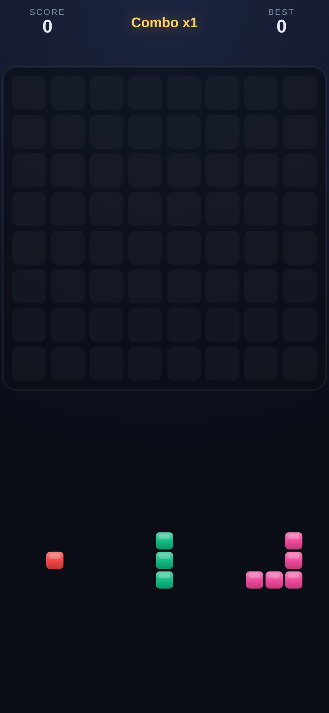

# Block Blast Clone

An open-source clone of the popular mobile puzzle game **Block Blast**. Drag blocks from
a hand of three onto an 8×8 grid; fill a row or column to clear it; chain clears for combo
bonuses; play until nothing fits.

- **Zero dependencies.** No frameworks, no build step, no bundler.
- **Runs anywhere.** Any modern browser on any OS — desktop or mobile.
- **MIT licensed.** Hack on it, fork it, ship it.



## Play it

**Play instantly in your browser:** <https://sswheatley.github.io/block_blast/>
(auto-deployed from `main` via GitHub Pages).

Prefer to run it locally? The game uses ES modules, so it must be served over `http://`
(not opened directly as a `file://` path). Pick whichever you have:

```bash
# Option A — Python (usually preinstalled)
python3 -m http.server 8080

# Option B — Node
npx serve . -l 8080
```

Then open <http://localhost:8080> in your browser.

## How to play

1. Drag one of the three blocks at the bottom onto the board.
2. A **green** preview means the spot is legal; **red** means it's blocked.
3. Fill an entire **row or column** to clear it and score points.
4. Clear on **consecutive moves** to build a combo multiplier.
5. The game ends when none of your remaining blocks fit anywhere.

## Documentation

- [`AGENTS.md`](AGENTS.md) — orientation for AI coding agents (and helpful for humans).
- [`docs/plan.md`](docs/plan.md) — roadmap, architecture, and phase progress.
- [`docs/game-design.md`](docs/game-design.md) — how the game actually works (rules,
  scoring formulas, systems). Kept in sync with the code.

## Project structure

```
index.html            Entry point
style.css             Theme, HUD, overlay
src/
  main.js             Bootstrap, game loop, wiring
  input.js            Pointer drag & drop (mouse + touch)
  storage.js          High-score persistence
  game/               PURE game logic (no DOM)
    pieces.js         Shape set + bag RNG
    board.js          8×8 grid + line clears
    scoring.js        Scoring formulas
    state.js          Game state machine
  render/
    layout.js         Viewport geometry
    renderer.js       Canvas drawing
```

## Contributing

See [CONTRIBUTING.md](CONTRIBUTING.md).

## License

[MIT](LICENSE). This is an independent, educational reimplementation. It is not affiliated
with the original game or its publisher, and ships with original code and visuals.

## Roadmap

See [`docs/plan.md`](docs/plan.md). Highlights: polish, PWA (installable/offline), optional Electron desktop
build, and optional Capacitor Android APK.
